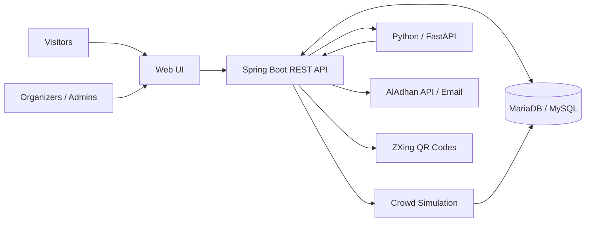
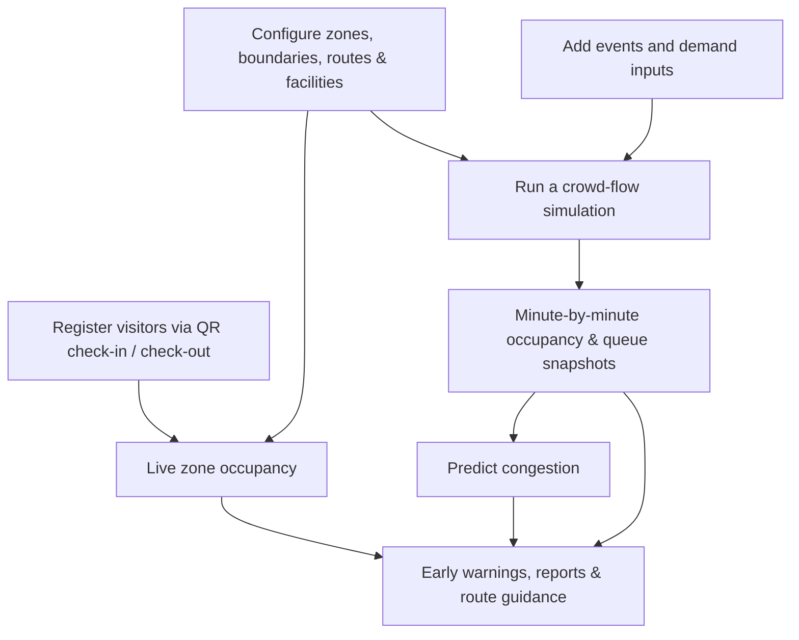

<div align="center">


# MERGAB | مِرقاب

### See the crowd. Predict the pressure. Guide the experience.

**An intelligent crowd-management and visitor navigation platform inspired by the operational needs of Expo Riyadh 2030.**

**منصة ذكية لرصد حركة الحشود، والتنبؤ بمستويات الازدحام، ومحاكاة تدفق الزوار، وتوجيههم عبر خريطة تفاعلية.**


**Team OMINX · Expo 2030 Challenge · Tuwaiq Academy**

[Overview](#-overview) · [Features](#-core-features) · [Architecture](#-system-architecture) · [Getting Started](#-getting-started) · [Team](#-meet-team-ominx)

</div>

---

## ✨ Overview

Large-scale events are dynamic. Visitor arrivals, popular exhibitions, facility demand, and changing crowd patterns can create bottlenecks across interconnected spaces. Responding only after congestion becomes visible may be too late.

**MERGAB (مِرقاب)** brings together **live occupancy monitoring, event-aware simulations, congestion prediction, and interactive wayfinding** in a single platform.

It is designed to help organizers understand crowd conditions and explore operational decisions—while giving visitors a clearer, more comfortable way to navigate the venue.

> **Our mission:** Turn crowd data into timely insight, and insight into a better visitor experience.

### The Problem We Address

| Challenge | MERGAB's Approach |
| :--- | :--- |
| Limited visibility into crowd density | QR-based zone entry/exit records and occupancy dashboards |
| Congestion spreading between areas | Connected zones, walkway capacities, and movement simulation |
| Difficulty anticipating peak demand | Event-driven arrival modeling and short-horizon congestion prediction |
| Visitors struggling to find a route or facility | Interactive map, facility access paths, and route recommendations |
| Operational decisions without clear comparisons | Simulation snapshots, queue tracking, reports, and interventions |
| Crowd movement changing around prayer times | Prayer-time integration and prayer-aware simulation logic |

---

## 🚀 Core Features

### 🧭 Interactive Expo Map & Smart Navigation

- Explore **mapped zones and their boundaries**, with live crowd-level indicators.
- Display **connections between zones**, internal walking paths, and mapped facilities.
- Support **direction-aware walking/access paths** and facility-specific connections.
- Locate events, facilities, and nearby services within the venue.
- Recommend routes between zones using the venue network and available simulation context.
- Present crowd conditions and alternative navigation options to visitors.

### 📊 Organizer Operations Center

- Monitor occupancy and crowd distribution across all configured zones.
- Create and manage **zones, capacities, mapped boundaries, and walking connections**.
- Configure **facilities and access paths**, including route direction and availability.
- Manage event locations, schedules, and expected visitor demand.
- View operational analytics, simulation results, and downloadable CSV reports.
- Review early-warning indicators to identify areas requiring attention.

### 🎬 Crowd-Flow Simulation

- Run **time-based simulations** of movement across connected venue zones.
- Account for **zone capacities, connection throughput, queues, and visitor flow**.
- Model arrivals influenced by scheduled events and historical attendance references.
- Incorporate prayer-related movement into supported simulation scenarios.
- Store **minute-by-minute occupancy and queue snapshots** for analysis.
- Explore operational interventions and continue simulation scenarios.

### 🤖 Congestion Prediction & Early Warnings

- Send recent simulation snapshots from the Java backend to a **Python/FastAPI prediction service**.
- Estimate near-future zone occupancy and classify congestion as **LOW, MEDIUM, or HIGH**.
- Compare predicted occupancy against configured zone capacity.
- Surface zone-level early warnings in the organizer experience.

> **Technical transparency:** The prediction service currently included in `mirqab-ai/` implements a **recent-snapshot trend-based baseline**, not a validated production ML model. No predictive-accuracy percentage is claimed. The Java backend also contains an analysis integration designed to call `/analyze`, but that endpoint is **not implemented** by the bundled FastAPI application.

### 🎟️ Visitor Experience & QR Check-In

- Visitor registration, account management, and personal QR generation.
- QR-based **check-in and check-out** by organizers.
- Prevent simultaneous active visits across different zones.
- Enforce zone capacity checks during check-in.
- View visit history and support manual check-out when needed.
- Browse upcoming events, venue facilities, and the interactive map.
- Access **Arabic-first pages with English-language support** in the visitor experience.

### 🕌 Prayer-Time Awareness

- Retrieve Riyadh prayer times using the **AlAdhan API**.
- Help visitors find prayer facilities and view daily prayer times.
- Support prayer preferences and prayer-related movement in simulation scenarios.
- Provide fallback sample timings when the external prayer service is unavailable.

### 🔐 Accounts & Administration

- **Role-based access:** `ADMIN`, `ORGANIZER`, and `VISITOR`.
- Authentication with **Spring Security** and password hashing via **BCrypt**.
- Admin user management and organizer registration.
- Email templates for welcome messages and password recovery.
- Password reset by time-limited verification code.

---

## 🏗️ System Architecture



### From Venue Data to Decisions



**Two data contexts are intentionally distinct:**

QR check-in/out provides *recorded live occupancy*, whereas simulations generate *scenario snapshots*.

The prediction service uses simulation snapshots, so simulated forecasts should not be presented as direct measurements of the real crowd.

---

## 🛠️ Tech Stack

| Layer | Technology |
| :--- | :--- |
| Backend | **Java 17**, **Spring Boot 4.1.1**, Spring MVC, Spring Data JPA, Hibernate |
| Frontend | **HTML5**, **CSS3**, **JavaScript**, **Thymeleaf** |
| Database | **MariaDB / MySQL** |
| Prediction Service | **Python**, **FastAPI**, Pydantic, Uvicorn |
| Security | **Spring Security**, BCrypt, role-based authorization |
| QR Codes | **ZXing** |
| External Integrations | **AlAdhan Prayer Times API**, SMTP Email |
| Testing | **JUnit / Spring Boot Test**, **pytest**, Postman |
| Collaboration | **Git**, **GitHub**, Team Integration Workflows |

---

## 📂 Project Structure

```text
Mergab/
├── mirqab-ai/
│   ├── main.py
│   ├── predictor.py
│   ├── schemas.py
│   ├── requirements.txt
│   └── test_*.py
│
├── src/
│   ├── main/
│   │   ├── java/com/example/mergab/
│   │   │   ├── Config/
│   │   │   ├── Controller/
│   │   │   ├── DTO/
│   │   │   ├── Model/
│   │   │   ├── Repository/
│   │   │   ├── Service/
│   │   │   └── Simulation/
│   │   │
│   │   └── resources/
│   │       ├── templates/
│   │       │   ├── admin/
│   │       │   ├── organizer/
│   │       │   └── visitor/
│   │       │
│   │       ├── static/
│   │       │   ├── css/
│   │       │   ├── js/
│   │       │   ├── map/
│   │       │   └── img/
│   │       │
│   │       └── application.properties
│   │
│   └── test/
│
├── pom.xml
├── mvnw
├── mvnw.cmd
└── README.md
```

---

## ⚙️ Getting Started

### Requirements

- JDK **17 or newer**
- Maven or Maven Wrapper
- MariaDB / MySQL
- Python 3 and pip

### 1. Create the Database

```sql
CREATE DATABASE Mergab
CHARACTER SET utf8mb4
COLLATE utf8mb4_unicode_ci;
```

Update `src/main/resources/application.properties` to match your local database configuration.

```properties
spring.datasource.url=jdbc:mysql://localhost:3306/Mergab
spring.datasource.username=root
spring.datasource.password=YOUR_LOCAL_PASSWORD
spring.jpa.hibernate.ddl-auto=update
```

> **Compatibility note:** The project uses Hibernate 7. Older MariaDB versions (such as 10.4) may create tables but fail to add some foreign-key constraints automatically. Use a compatible database/version and verify the foreign keys before inserting linked data.

### 2. Start the Python Prediction API

Open a terminal in the project root.

**Windows (PowerShell):**

```powershell
cd mirqab-ai
python -m venv .venv
.\.venv\Scripts\python.exe -m pip install -r requirements.txt
.\.venv\Scripts\python.exe -m uvicorn main:app --host 127.0.0.1 --port 8001
```

**macOS / Linux:**

```bash
cd mirqab-ai
python3 -m venv .venv
.venv/bin/python -m pip install -r requirements.txt
.venv/bin/python -m uvicorn main:app --host 127.0.0.1 --port 8001
```

**Service URLs:**

- Health Check: `http://127.0.0.1:8001/health`
- Swagger UI: `http://127.0.0.1:8001/docs`

The Spring Boot prediction client communicates with:

```text
http://127.0.0.1:8001/predict
```

### 3. Start Spring Boot

From a second terminal, in the project root:

**Windows:**

```powershell
.\mvnw.cmd spring-boot:run
```

**macOS / Linux:**

```bash
./mvnw spring-boot:run
```

Open:

**http://localhost:8080**

### 4. Optional Email Setup

Welcome emails and password reset emails use SMTP.

The application configuration supports:

```properties
MAIL_USERNAME
MAIL_PASSWORD
```

Provide valid SMTP credentials through environment variables to enable email functionality.

> **Security:** Never commit real database passwords, SMTP credentials, API keys, personal QR tokens, or identifiable visitor records.

### 5. Prepare Demonstration Data

Before running a meaningful simulation, configure:

1. Zones and their capacities.
2. Map boundaries and coordinates.
3. Connections between zones.
4. Internal walking paths.
5. Facilities and their access paths.
6. Events and expected visitor demand.
7. Historical attendance records.

Simulations and forecasts depend on these inputs.

The repository does not include an automated first-admin bootstrap or a complete seeded Expo venue database.

An authorized admin account and connected venue data must be initialized for a fresh local environment.

---

## 🔗 Selected REST API Endpoints

All application endpoints below are prefixed with `/api/v1`.

| Method | Endpoint | Description |
| :--- | :--- | :--- |
| `POST` | `/visitor/register` | Register a visitor |
| `GET` | `/visitor/my-qr-code` | Generate the authenticated visitor's QR image |
| `POST` | `/zone-visit/check-in/{zoneId}` | Record a visitor's zone entry from QR token |
| `PUT` | `/zone-visit/check-out/{zoneId}` | Record a visitor's zone exit |
| `GET` | `/zone-visit/occupancy/{zoneId}` | Retrieve recorded active occupancy |
| `GET` | `/zone/get` | Retrieve mapped zones |
| `GET` | `/zone-connection/get` | Retrieve connections between zones |
| `GET` | `/zone-walk-path/get-active-by-zone/{zoneId}` | Get active internal walking paths |
| `GET` | `/facility-access-path/get-active-by-facility/{facilityId}` | Get facility access paths |
| `GET` | `/expo-event/get-upcoming` | Browse upcoming events |
| `POST` | `/simulation/run/{id}` | Execute a configured simulation |
| `POST` | `/simulation/continue/{id}` | Continue a simulation |
| `GET` | `/simulation-snapshot/get-by-simulation/{simulationId}` | Retrieve simulation snapshots |
| `GET` | `/ai/predict/{simulationId}/{zoneId}` | Predict zone congestion from snapshots |
| `GET` | `/ai/early-warnings/{simulationId}` | Retrieve simulation-based early warnings |
| `POST` | `/routes/recommend` | Request a recommended route |
| `GET` | `/prayer/today` | Retrieve daily prayer times |

The API includes additional CRUD and operational endpoints.

See the `Controller/` and `DTO/` packages for complete request formats and access rules.

---

## 🧪 Testing

### Java / Spring Boot

```powershell
.\mvnw.cmd test
```

### Python / FastAPI

```powershell
cd mirqab-ai
.\.venv\Scripts\python.exe -m pytest -v
```

Tests are included for:

- Simulation movement.
- Event arrivals.
- Route finding.
- Historical demand scaling.
- Prayer-aware movement.
- Python prediction logic.

These commands run the available tests. No unverified coverage or predictive-accuracy percentage is claimed.

---

## 👥 Meet Team OMINX

Four developers from **Tuwaiq Academy**, collaborating across full-stack software development and artificial intelligence.

| Team Member | Contribution |
| :--- | :--- |
| **Lama Alharbi — لمى الحربي** | Backend & Frontend Development |
| **Dana Alshammari — دانة الشمري** | Backend & Frontend Development |
| **Razan Al Madan — رزان آل مدن** | AI & Machine Learning |
| **Dana Alsahli — دانه السهلي** | AI & Machine Learning |

### Bootcamp

**معسكر تطوير مواقع الويب باستخدام جافا ودمج تقنيات الذكاء الاصطناعي**

*Web Development Using Java and AI Integration Bootcamp — Tuwaiq Academy*

---

## 📌 Project Scope

MERGAB is a **functional academic/challenge prototype**, designed to demonstrate how connected venue data, crowd-flow modeling, predictive indicators, and visitor navigation can support large-event operations.

Its sample venue content and metrics are illustrative; they are **not official Expo Riyadh 2030 operational data**.

Production deployment would require further validation, security hardening, and infrastructure planning.

---

<div align="center">

### MERGAB | مِرقاب

**From crowd awareness to proactive decisions.**

*Created for the Expo 2030 Challenge.*

*Not affiliated with or endorsed by Expo Riyadh 2030.*

</div>
